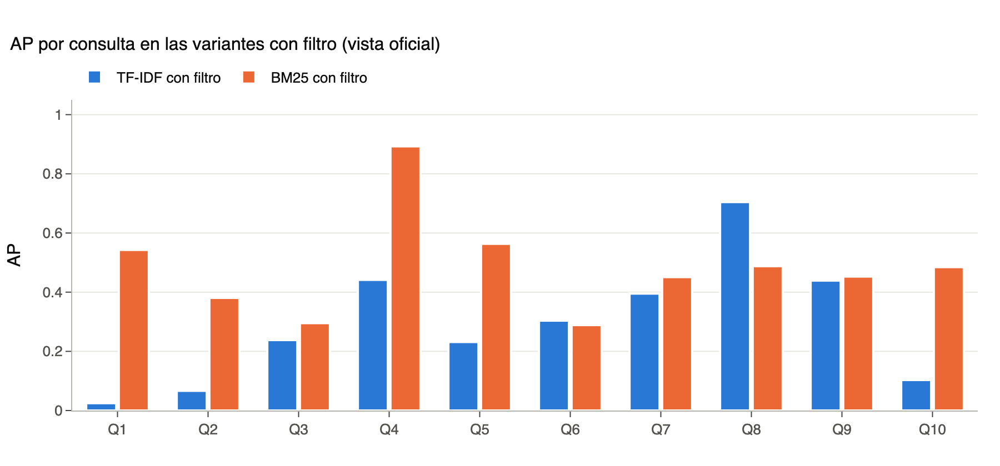
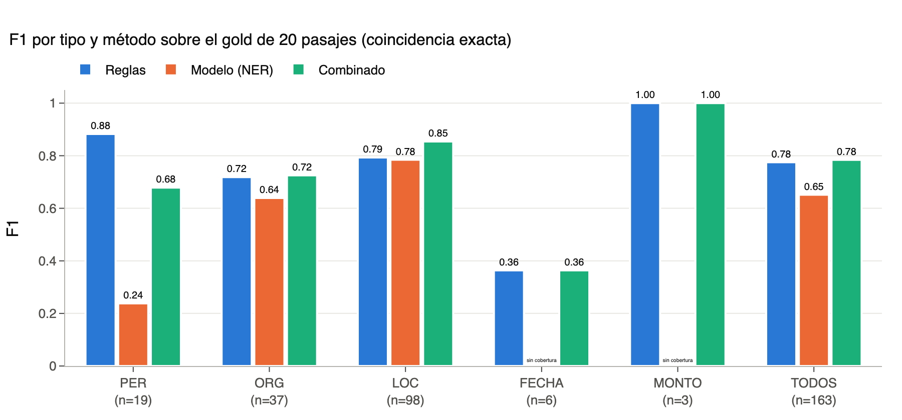

<strong style="font-size:15pt;color:#1a1a1a">Recuperación y extracción de información sobre discursos presidenciales</strong> 
Diego Moctezuma · Minería de Textos, Examen 1 · 11 de noviembre de 2026 · Repositorio: pendiente de confirmar destino (ver README)

## 1. Datos, limpieza y segmentación

El corpus son las versiones estenográficas de conferencias y discursos presidenciales de diciembre de 2018 a septiembre de 2024. La limpieza retira duplicados exactos y casi duplicados y elimina las acotaciones de transcripción entre corchetes (inaudible, inicia video, himno nacional); cada eliminación queda auditada en salida/01_auditoria_corpus.csv. El formato real del corpus difiere del supuesto por el kit: las marcas de interlocutor llegan como etiquetas en línea, y el reconocedor del kit no detecta ninguna en los 2,294 discursos, de modo que la limpieza las canoniza a una intervención por línea antes de segmentar.

<!-- tabla:corpus -->
| Concepto | Valor |
| --- | --- |
| Discursos en el snapshot | 2,294 |
| Periodo | 2018-12-02 a 2024-09-30 |
| Palabras por discurso (mediana) | 8,502 |
| Duplicados exactos / casi duplicados excluidos | 4 / 1 |
| Acotaciones eliminadas (inaudible, video, etc.) | 7,338 |
| Pasajes indexados | 127,739 |
| Pasajes de reporteros | 19,844 (15.5%) |
<!-- /tabla:corpus -->

La unidad de recuperación es el pasaje: cada intervención se parte en ventanas de 200 palabras con paso de 150 y mínimo de 40 (base del kit, decisión D02). Al inicio del texto de cada pasaje se reinyecta la marca del interlocutor, que sirve para extraer personas y cargos, y su longitud queda registrada para excluirla del índice. Las intervenciones de reporteros se conservan e indexan igual que las del presidente porque la pregunta suele nombrar el tema. El costo de la base D02 es alto para ellos: el 64.94 % de sus intervenciones queda por debajo de 40 palabras y se descarta, cifra que supera el 10 % previsto y que se discute como limitación.

## 2. Preprocesamiento e índice invertido

Los textos se normalizan a NFC y minúsculas; los tokens son secuencias alfanuméricas con un guion interno opcional, lo que conserva covid-19. La stoplist une las 313 palabras de NLTK con una lista propia de la estenográfica (presidente, gracias, pregunta, entonces, pues), 336 en total, y se descartan los tokens de dos letras o menos salvo los numéricos. Se aplica stemming Snowball en español en lugar de lematización por velocidad sobre 127 mil pasajes. El índice invertido se escribe a mano: para cada raíz guarda los pasajes con su frecuencia y la longitud de cada pasaje (promedio de 72.2 tokens del cuerpo). La tabla resume los postings de cuatro términos; huachicol tiene el idf más alto porque aparece en menos del 1 % de los pasajes.

| Término | Raíz | df (pasajes) | % de pasajes | idf BM25 |
| --- | --- | ---: | ---: | ---: |
| tren | tren | 5,261 | 4.12 | 3.190 |
| vacuna | vacun | 4,552 | 3.56 | 3.334 |
| refinería | refin | 2,069 | 1.62 | 4.123 |
| huachicol | huachicol | 714 | 0.56 | 5.186 |

Fuente: salida/02_postings.md, con los 15 pasajes de mayor tf por término.

## 3. Ranking y evaluación de IR

TF-IDF usa tf sublineal e idf suavizado, $w = (1+\ln tf)\,(\ln\frac{1+N}{1+df}+1)$, con similitud coseno sobre vectores normalizados. BM25 se implementa a mano con $k_1 = 1.5$ y $b = 0.75$, idf $\ln\left(1+\frac{N-df+0.5}{df+0.5}\right)$ y puntaje $\sum_t idf_t \frac{tf\,(k_1+1)}{tf + k_1(1-b+b\,|d|/avgdl)}$. Cada modelo corre con y sin el filtro de fecha de la consulta, y se recuperan los 10 mejores pasajes. Los juicios de relevancia los hizo el alumno sobre un pool de 176 pares, la unión de las cuatro variantes, sin ver modelo, rango ni puntaje, y juzgando el tema con independencia de la fecha. La vista oficial mide relevancia temática; la vista con ventana considera relevante solo lo que además cae dentro del periodo.

Relevancia temática (resultados_ir.csv)

<!-- tabla:ir -->
| Variante | P@5 | P@10 | MAP |
| --- | --- | --- | --- |
| TF-IDF sin filtro | 0.42 | 0.41 | 0.287 |
| TF-IDF con filtro | 0.44 | 0.43 | 0.295 |
| BM25 sin filtro | 0.56 | 0.56 | 0.469 |
| BM25 con filtro | 0.54 | 0.59 | 0.484 |
<!-- /tabla:ir -->

Relevancia dentro de la ventana

<!-- tabla:ir_ventana -->
| Variante | P@5 | P@10 | MAP |
| --- | --- | --- | --- |
| TF-IDF sin filtro | 0.36 | 0.36 | 0.263 |
| TF-IDF con filtro | 0.44 | 0.43 | 0.332 |
| BM25 sin filtro | 0.46 | 0.46 | 0.418 |
| BM25 con filtro | 0.54 | 0.59 | 0.523 |
<!-- /tabla:ir_ventana -->

BM25 con filtro es el mejor modelo y define el ámbito de la extracción (decisión D08). BM25 gana en 8 de 10 consultas; la explicación probable es la saturación de tf y la normalización por longitud, que evitan que un término repetido domine el puntaje. El caso extremo es Q1, donde el stemmer reduce Maya y mayo a la misma raíz may, lo que mezcla fechas con la obra; TF-IDF obtiene AP 0.025 y BM25 0.543. TF-IDF solo gana en Q6 y Q8. Q8 es una consulta larga de cinco términos y ahí la diferencia favorece a TF-IDF por 0.216. En la vista temática el filtro ayuda poco a BM25 (0.469 a 0.484) porque hay relevantes fuera de la ventana; en la vista con ventana la ganancia sube a 0.418 frente a 0.523. Q6 muestra el efecto más marcado del filtro: sin él, 9 y 10 de los 10 pasajes de TF-IDF y BM25 caen fuera de su ventana. En cambio, en Q3 el filtro baja el AP temático de BM25 de 0.468 a 0.295 porque 2 de sus 7 pasajes relevantes en el pool caen fuera de la ventana.

<!-- tabla:ir_consulta -->
| Consulta | AP TF-IDF | AP BM25 | Gana |
| --- | --- | --- | --- |
| Q1 | 0.025 | 0.543 | BM25 |
| Q2 | 0.067 | 0.381 | BM25 |
| Q3 | 0.238 | 0.295 | BM25 |
| Q4 | 0.442 | 0.893 | BM25 |
| Q5 | 0.232 | 0.564 | BM25 |
| Q6 | 0.304 | 0.289 | TF-IDF |
| Q7 | 0.395 | 0.451 | BM25 |
| Q8 | 0.704 | 0.488 | TF-IDF |
| Q9 | 0.439 | 0.453 | BM25 |
| Q10 | 0.103 | 0.484 | BM25 |
<!-- /tabla:ir_consulta -->

<figure><figcaption>AP por consulta y variante.</figcaption></figure>

La consulta más difícil es Q3 (AP máximo 0.295 con filtro): el corpus alterna Dos Bocas y refinería Olmeca, y el segundo nombre no está en la consulta. Un modelo de embeddings densos ayudaría justo en esos sinónimos: Q3 (refinería Olmeca), Q4 (AIFA frente a Felipe Ángeles), Q6 (robo de combustible frente a huachicol) y Q7 (pensión del Bienestar frente a pensión universal).

## 4. Extracción con reglas y con modelo

Las reglas trabajan sobre el texto original con mayúsculas y acentos. Las expresiones regulares de FECHA cubren fechas absolutas, mes y año, años con contexto temporal e intervalos, con el modificador relativo dentro del span y la preposición fuera. Las de MONTO exigen cifra, escala y moneda o símbolo. Porcentajes, dosis, litros y sucursales se guardan como cantidades auxiliares y nunca como MONTO. Quedan sin cubrir las fechas en palabras (quince de enero) y las cifras escritas del todo con letra. El gazetteer ORG parte de las 76 entradas del kit y suma 16 manuales y 60 siglas minadas del corpus, que el alumno revisó una por una (104 candidatas, 44 descartadas): 152 entradas en total. El gazetteer LOC tiene 102 entradas: las 32 entidades federativas con variantes, municipios de las consultas, países y las obras con nombre propio, que se anotan como LOC. Una regla adicional extrae la persona de la marca de interlocutor quitando el cargo por lista. Ante solapes gana el span más largo. Las reglas se congelaron con la etiqueta git reglas-congeladas antes de abrir el gold y no cambiaron después.

El modelo es mrm8488/bert-spanish-cased-finetuned-ner con revisión fija, elegido por criterio técnico (cabeza NER afinada, tokenizador rápido con offsets, CPU) antes del gold; no hubo conjunto de selección por recorte de alcance. Corre solo sobre los 99 pasajes del top-10, en ventanas con solapamiento y caché versionada, y su salida se posprocesa: recorte de puntuación y unión de spans contiguos del mismo tipo. La fusión es por coincidencia exacta de tipo y offsets: 312 entidades salen como ambos, 240 solo de reglas y 348 solo del modelo; los 138 solapes parciales se conservan como filas separadas y se registran aparte. La normalización produce fechas ISO con su precisión y montos con valor decimal, escala y moneda en un archivo enriquecido, sin tocar los spans evaluados.

## 5. Evaluación de IE y análisis de errores

El gold son 20 pasajes sorteados con semilla 42 (dos por consulta, uno del rango 1 a 5 y otro del 6 a 10), anotados a mano por el alumno en modo ciego con 163 entidades. El kit evalúa los 20 pasajes; la evaluación complementaria sobre los 20 IDs del manifiesto da las mismas cifras porque ningún pasaje quedó vacío.

<!-- tabla:ie -->
| Método | F1 PER | F1 ORG | F1 LOC | F1 FECHA | F1 MONTO | F1 TODOS | P TODOS | R TODOS |
| --- | --- | --- | --- | --- | --- | --- | --- | --- |
| regla | 0.88 | 0.72 | 0.79 | 0.36 | 1.00 | 0.78 | 0.89 | 0.69 |
| modelo | 0.24 | 0.64 | 0.78 | s/c | s/c | 0.65 | 0.70 | 0.61 |
| combinado | 0.68 | 0.72 | 0.85 | 0.36 | 1.00 | 0.78 | 0.73 | 0.85 |
| soporte gold | 19 | 37 | 98 | 6 | 3 | 163 |  |  |
<!-- /tabla:ie -->

F1 por tipo y método (resultados_ie.csv). s/c: el modelo no cubre FECHA ni MONTO.

La combinación sube el recall total de 0.69 (reglas) a 0.85 a cambio de precisión, y su F1 total (0.784) apenas supera al de reglas (0.775). Las reglas dominan en PER (0.88) porque la marca de interlocutor da nombres completos, y el modelo aporta recall en LOC y ORG. El peor resultado es PER del modelo (0.24): en la marca, escrita toda en mayúsculas, el modelo parte los nombres en fragmentos. Por ejemplo, en el pasaje 1122_3 predice MAN y L en lugar de ANDRÉS MANUEL LÓPEZ OBRADOR, lo que explica 18 falsos positivos dentro de la marca. Sin el experimento de capitalización no se afirma que la causa sean las mayúsculas, solo dónde ocurre. Otros casos observados son la entidad partida (Pfizer en lugar de Pfizer-BioNTech, 1188_80), la frontera de FECHA por convención (el gold incluye el día de la semana, domingo 28 de marzo, y la regla detecta 28 de marzo), el conflicto de tipo de obra LOC u ORG (Tren Maya como ORG del modelo, 326_25) y omisiones de lugares fuera de los gazetteers (California, 2045_9). No apareció ningún caso de sigla no reconocida ni de monto sin unidad. Con solo 6 FECHA y 3 MONTO en el gold, esas cifras son poco estables.

<!-- tabla:errores -->
| Categoría | FN (filas) | FP (filas) |
| --- | ---: | ---: |
| en_marca | 2 | 22 |
| frontera | 12 | 39 |
| omision | 8 | 0 |
| tipo | 3 | 5 |
<!-- /tabla:errores -->

Una fila puede llevar más de una categoría; sin subcategorías (salida/09_resumen_errores.csv).

<figure><figcaption>F1 por tipo y método.</figcaption></figure>

## 6. Tablas de respuesta

Para cada consulta se responde la pregunta de extracción con las entidades del top-10 de BM25 con filtro, después de quitar las entidades de la marca de interlocutor y las variantes del nombre del presidente en los campos de persona. Un valor es respaldado cuando su oración y una ventana de 60 caracteres contienen los patrones de la relación que pide la pregunta, fijados antes de generar las tablas; si no, queda ambiguo con su cita. Respaldado significa que el texto lo afirma, no que sea verdad. Las tablas completas con cita y pasaje están en salida/tablas_respuesta; la tabla resume cada consulta con la valoración escrita por el alumno, reproducida sin cambios.

<!-- tabla:respuestas -->
**Q1 avances en la construcción del Tren Maya.** 5 valores respaldados, 4 ambiguos; campos sin evidencia: montos. *Valoración del alumno:* "Tren Maya" debe ser un lugar en vez catalogarlo como dependencia o empresa. Tiene un problema con las NER ya que separó "Grupo ICA" e "ICA". "Cuxtal" no tiene relacón con dependencia o empresa. Los estados que salen con el tren maya pueden ser catalogados como lugar donde pasa el tren, Sin evidencia en el top-10 puede deberse a los juicios donde no se encontró nada referente

**Q2 llegada y aplicación de vacunas contra el COVID-19.** 21 valores respaldados, 3 ambiguos; campos sin evidencia: ninguno. *Valoración del alumno:* La tabla es creíble por que identifica bien los nombres propios de los funcionarios, fechas, dosis y farmacéuticas. Para "Sputnik V" toma bien la regla del gold donde se debe poner los nombres de las vacunas como organizaciones. Falta devolver fechas sobre aplicaciones de las vacunas ya que solo están las llegadas al país. Es correcto catalogar "mil 200 vacunas" como dosis aunque no tenga la palabra explicita.

**Q3 refinería de Dos Bocas en Tabasco.** 10 valores respaldados, 9 ambiguos; campos sin evidencia: ninguno. *Valoración del alumno:* Es poco creíble la tabla. Para organizaciones toma nombres de noticieros ya que se toma mucho el tema de "desinformación", solo "Pemex" es una organización relacionada con la refinería. Toma a "Carlos Loret de Mola" como responsable pero es un periodista. Solo hay una cifra de montos de inversión y es correcta, los faltantes se pueden deber a la falta de empresas contratistas reales. Hay problemas con NER ya que obtuvo "Ref" como organización.

**Q4 aeropuerto Felipe Ángeles en Santa Lucía.** 20 valores respaldados, 8 ambiguos; campos sin evidencia: ninguno. *Valoración del alumno:* La tabla es poco creíble. Faltan dependencias constructoras , hay ruido como "Colegio Militar", "Mitre" o estados, estosno deben pertenecer a esta categoría. Se hablan de otros aeropuertos y eso está bien ya que están relacionados pero "Felipe Ángeles" debería tomarse completo con aeropuerto antes del nombre para que sea el lugar. De costos solo hay uno "100 mil millones de pesos" puede deberse a que faltan pasajes donde se hable de las dependencias constructoras.

**Q5 programa Sembrando Vida y apoyo a campesinos.** 9 valores respaldados, 11 ambiguos; campos sin evidencia: ninguno. *Valoración del alumno:* La tabla es poco creíble. No menciona ninguna secretaría operadora, menciona dos organizaciones ficticias ("Asociación Campesina Independiente Emiliano Zapata", "Organización Campesina Independiente Emiliano") y la "SEDENA" no la menciona como operadora. No hay ningún problema con los estados, todos están relacionados con la query. El monto por beneficiario es de "cinco mil pesos" y solo sale una vez, las otras cantidades hacen referencia a la inversión en el programa.

**Q6 combate al huachicol y robo de combustible.** 9 valores respaldados, 7 ambiguos; campos sin evidencia: ninguno. *Valoración del alumno:* La tabla es poco creíble. Se menciona "Michoacán" como lugar pero no se relaciona nada con la consulta ya que solo se pregunta por el presupuesto del estado, falta mencionar el monto del presupuesto y para que lo ocupan. Hay problemas con NER ya que pone "Interven" como organización, la única organización es "Pemex". Solo "65 mil millones de pesos" y "56 mil millones de pesos" son las perdidas, las otras cantidades son ahorros y presupuesto para medicina, también se menciona la cantidad en el pasaje como "mil millones de pesos" sin más contexto.

**Q7 pensión universal para adultos mayores.** 12 valores respaldados, 9 ambiguos; campos sin evidencia: ninguno. *Valoración del alumno:* La tabla es algor creíble. Se menciona el monto real bimestral pero también toma el monto anterior al cambio "mil 160 pesos", aparece el presupuesto en millones de pesos y otro monto referente a una beca "mil 600 pesos". Hay un problema con NER ya que "Issste" lo separó en "Is". Las fechas son correctas y hablan sobre los aumentos.

**Q8 aumento al salario mínimo y acuerdo con empresarios.** 6 valores respaldados, 2 ambiguos; campos sin evidencia: organizaciones empresariales. *Valoración del alumno:* La tabla es parcialmente creíble. Se toman algunos porcentajes que no hablan del salario mínimo como "50 por ciento" que se refiere al tiempo y "75 por ciento" que se refiere al poder de compra del salario. Para montos se menciona "tres mil 600 pesos" pero habla de un programa no del salario. Hace falta tener más montos diarios.

**Q9 operación y apertura de sucursales del Banco del Bienestar.** 22 valores respaldados, 2 ambiguos; campos sin evidencia: ninguno. *Valoración del alumno:* La tabla es parcialmente creíble. Hay muchas repeticiones para "El banco del bienestar" en plural, singular y en un error con "de" en vez de "del". "Azteca" no debe de pertenecer ya que es otro banco y solo se usa para comparar el número de sucursales. Sucursales y estados todos son correctos y no hay ruido de otros temas. Para montos solo hay "600 mil millones de pesos" falta tener más información sobre montos de inversión, construcción, etc.

**Q10 construcción y operación del Tren Interoceánico del Istmo de Tehuantepec.** 35 valores respaldados, 23 ambiguos; campos sin evidencia: ninguno. *Valoración del alumno:* La tabla es parcialmente creíble. Hay problemas con el NER ya que pone "eánico" de "oceánico" y "pec", "huantepec" de "Tehuantepec". Faltan empresas constructuras que se encargan del ferrocarril ya que solo hay dependencias, también falta fechas de inauguración, solo hay fechas de información. Hace falta más montos de construcción debido a la falta de mención de estas mismas empresas.
<!-- /tabla:respuestas -->

## 7. Uso de IA, limitaciones y reproducibilidad

El código, las pruebas, la app de anotación y la prosa de este reporte, del README y del guion los redactó un asistente (Claude Code) a partir de resultados reales; el alumno los revisó y corrigió. El alumno decidió la fase 0, los criterios de relevancia y de anotación, las consultas Q9 y Q10, la revisión de siglas, las convenciones de los casos no previstos y las valoraciones, y consultó a Gemini como tutor para dudas de criterio sin que redactara contenido. Los juicios de relevancia y el gold se hicieron a mano en la app leyendo cada pasaje, en modo ciego para el gold; el asistente no generó ni sugirió esos valores. El código se verificó con 433 pruebas automáticas y validadores de formato de cada entregable. Las limitaciones principales son el descarte de intervenciones cortas de reporteros, un gold de 20 pasajes con poco soporte en FECHA y MONTO, la elección técnica del NER sin conjunto de selección y patrones de relación que en algunos campos dejan pasar valores sin la relación pedida, como señalan las valoraciones. Desde un clon limpio, make resultados reproduce todas las cifras con los insumos humanos y la caché NER versionados; los pasos y tiempos medidos están en docs/reproducibilidad.md.
