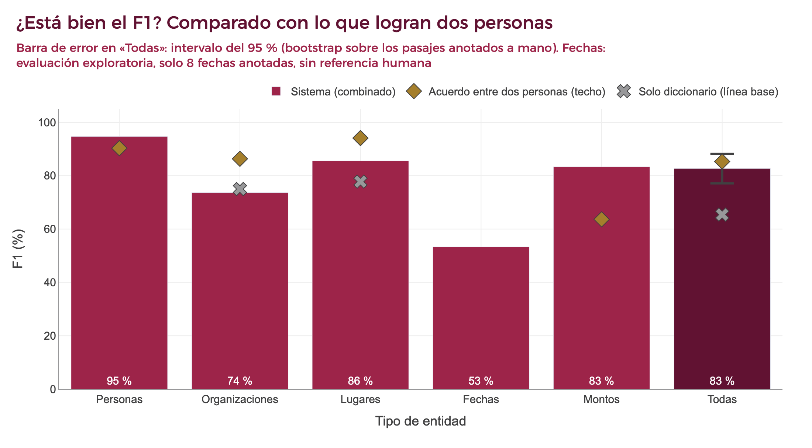

<strong style="font-size:15pt;color:#691C32">Recuperación y extracción de información sobre discursos presidenciales</strong> 
Proyecto final · Equipo Datisa: Carpio Angeles Leo Yahir, Jaramillo Salmerón Arturo, Mera Montiel Gonzalo Sebastian, Moctezuma Ramirez Diego Rafael y Ramirez Maza Luis 
Minería de Textos · 25 de noviembre de 2026 · Repositorio: https://github.com/DiegoMoctezuma/Examen_Mineria_Textos

Este reporte describe la versión final del sistema. Parte del examen entregado el 11 de noviembre (v1) y atiende la retroalimentación del profesor con más preguntas, juicios de tres personas, un gold más grande con doble anotación, una comparación de modelos NER y referencias para leer el F1. La tabla resume qué cambió; las cifras v1 se conservan en el repositorio y no se sobrescriben.

| Tema | Examen (v1) | Proyecto final (v2) |
| --- | --- | --- |
| Preguntas | 10 | 15 (se suman Guardia Nacional, IMSS-Bienestar, Reforma eléctrica, Jóvenes Construyendo el Futuro y Acapulco tras Otis) |
| Variantes de búsqueda | 4: TF-IDF y BM25, con y sin filtro | 8: las mismas con raíz (stemming) y con lema |
| Juicios de relevancia | 1 persona, 176 pares | 3 personas por par, mayoría, 320 pares, κ de Fleiss 0.48 |
| Mejor búsqueda | BM25 con filtro, MAP 48.4 % | BM25 con raíz y filtro, MAP 53.6 % (IC95 43.3 % a 64.1 %) |
| Modelo NER | mrm8488, elegido por criterio técnico | XLM-RoBERTa large, elegido entre 4 por F1 sobre un conjunto de selección |
| Gold de entidades | 20 pasajes, 1 persona | 35 pasajes: los 20 de v1 más 15 nuevos con doble anotación y adjudicación |
| F1 combinado | 78.4 % | 82.7 % (IC95 77.1 % a 88.2 %), contra 85.3 % de techo humano y 65.4 % de línea base |

Fuentes: salida/v2/resultados_ir.csv, salida/v2/05_robustez.csv, salida/v2/05a_acuerdo.csv, salida/v2/09_comparacion_ner.csv, salida/v2/resultados_ie.csv, salida/v2/09_referencias_f1.csv; v1 en salida/.

## 1. Datos, limpieza y segmentación

El corpus son las versiones estenográficas de conferencias y discursos presidenciales de diciembre de 2018 a septiembre de 2024. Esta parte no cambió en v2, porque cambiarla invalidaría los juicios y el gold de v1. De 2,294 discursos descargados se excluyen 4 duplicados exactos y 1 casi duplicado (2,289), y 2,288 producen al menos un pasaje. La limpieza elimina 7,338 acotaciones del transcriptor, que son notas como «inaudible», «inicia video» o «himno nacional» y no palabras de nadie; cada eliminación queda auditada. Las marcas de interlocutor llegan como etiquetas en línea que el reconocedor del kit no detecta en ningún discurso, por lo que la limpieza las canoniza a una intervención por línea antes de segmentar.

| Concepto | Valor |
| --- | --- |
| Discursos descargados / sin duplicados / con pasajes | 2,294 / 2,289 / 2,288 |
| Periodo | 2018-12-02 a 2024-09-30 |
| Acotaciones eliminadas | 7,338 |
| Pasajes indexados | 127,739 |
| Pasajes de reporteros | 19,844 (15.5 %) |

La unidad de recuperación es el pasaje: cada intervención se parte en ventanas de 200 palabras con paso de 150 y mínimo de 40. La marca del interlocutor se reinyecta al inicio del pasaje para extraer personas y cargos, y se excluye del índice. Los pasajes de reporteros se indexan como cualquier otro: el 15.5 % del índice son preguntas, y sirven porque nombran el tema. Lo que se descarta es todo fragmento de menos de 40 palabras, sea de quien sea, porque es demasiado corto para entenderse solo; eso afecta al 64.94 % de las intervenciones de reporteros, que suelen ser breves. En las tablas de respuesta lo que dice un reportero nunca cuenta como respaldo (sección 6).

## 2. Preprocesamiento e índice invertido

Los textos se normalizan a NFC y minúsculas; los tokens son secuencias alfanuméricas con un guion interno opcional, lo que conserva covid-19. Se quitan las palabras vacías que no distinguen temas: 336 en total, las de NLTK más una lista propia de la estenográfica (presidente, gracias, pregunta, entonces, pues). En v1 cada palabra se reduce a su raíz con el stemmer Snowball; en v2 se agrega una segunda versión con el lema de spaCy (es_core_news_md), con los mismos tokens, de modo que solo cambia la forma base. El lema separa palabras que la raíz junta: maya y mayo comparten la raíz may (6,504 pasajes), y con lema quedan como maya (4,344) y mayo (2,151). El vocabulario pasa de 35,891 a 68,482 términos.

El índice invertido se escribe a mano: para cada término guarda la lista de pasajes donde aparece con su frecuencia, y la longitud de cada pasaje (72.2 tokens en promedio). La rareza de un término se mide con el idf: entre menos pasajes lo contienen, más pesa.

| Término | Raíz | Pasajes | % de pasajes | idf BM25 |
| --- | --- | ---: | ---: | ---: |
| programa | program | 12,803 | 10.02 | 2.30 |
| tren | tren | 5,261 | 4.12 | 3.19 |
| refinería | refin | 2,069 | 1.62 | 4.12 |
| huachicol | huachicol | 714 | 0.56 | 5.19 |

Fuentes: salida/02_postings.md y salida/v2/02_comparacion_stem_lema.md.

## 3. Ranking y evaluación de IR

TF-IDF usa tf sublineal e idf suavizado, $w = (1+\ln tf)\,(\ln\frac{1+N}{1+df}+1)$, con similitud coseno. BM25 se implementa a mano con $k_1 = 1.5$ y $b = 0.75$, idf $\ln\left(1+\frac{N-df+0.5}{df+0.5}\right)$ y puntaje $\sum_t idf_t \frac{tf\,(k_1+1)}{tf + k_1(1-b+b\,|d|/avgdl)}$. Cada modelo corre con raíz y con lema, con y sin el filtro de fecha de la pregunta, y devuelve los 10 mejores pasajes.

**Juicios.** El pool es la unión de los 10 primeros de las 8 variantes: 320 pares (176 de v1 y 144 nuevos). Cada par lo juzgaron tres personas por separado, sin ver modelo, rango ni puntaje; un par es relevante si al menos 2 de 3 dicen que sí (196 de 320). El acuerdo entre jueces es moderado: κ de Fleiss de 0.48 (0.42 en el lote 1 y 0.54 en el lote 2).

**Resultados.** El ganador se elige entre las variantes con filtro, porque el sistema siempre usa el periodo de la pregunta (regla fijada antes de ver los juicios). Gana BM25 con raíz y filtro, con MAP de 53.6 %. El intervalo de confianza del 95 % se calcula con 10,000 remuestreos de las preguntas.

| Variante | P@5 | P@10 | MAP | IC95 |
| --- | ---: | ---: | ---: | --- |
| BM25 raíz con filtro | 0.79 | 0.77 | **0.536** | 0.433 a 0.641 |
| BM25 raíz sin filtro | 0.76 | 0.75 | 0.527 | 0.410 a 0.640 |
| BM25 lema sin filtro | 0.79 | 0.72 | 0.515 | 0.403 a 0.626 |
| BM25 lema con filtro | 0.76 | 0.72 | 0.507 | 0.399 a 0.618 |
| TF-IDF raíz con filtro | 0.64 | 0.59 | 0.352 | 0.267 a 0.445 |
| TF-IDF lema con filtro | 0.67 | 0.61 | 0.349 | 0.283 a 0.418 |
| TF-IDF lema sin filtro | 0.61 | 0.59 | 0.337 | 0.259 a 0.412 |
| TF-IDF raíz sin filtro | 0.57 | 0.55 | 0.331 | 0.232 a 0.434 |

<figure><figcaption>AP por pregunta y variante, 15 preguntas.</figcaption></figure>

Fuentes: salida/v2/05_ir_8_variantes.csv y salida/v2/05_robustez.csv.

La ventaja de BM25 sobre TF-IDF con filtro (18.4 puntos de MAP) es estable: una prueba de permutación pareada sobre las 15 preguntas da p = 0.014. Por pregunta, BM25 gana en 10, TF-IDF en 4 (Dos Bocas, IMSS-Bienestar, Jóvenes Construyendo el Futuro y Acapulco tras Otis) y hay un empate (Banco del Bienestar). La saturación de tf y la normalización por longitud de BM25 evitan que un término repetido domine; el caso más claro es Tren Maya, con AP de 0.90 en BM25 contra 0.17 en TF-IDF. Dos de las preguntas que gana TF-IDF tienen un nombre alterno que no está en la consulta: Dos Bocas, que el corpus también llama refinería Olmeca, e IMSS-Bienestar, que hasta 2023 aparece como Insabi. En esos casos ningún modelo léxico encuentra el sinónimo, y un modelo de embeddings densos sería el siguiente paso natural.

El lema no mejora el MAP: con filtro, la raíz da 53.6 % y el lema 50.7 %, y la diferencia no es significativa (p = 0.07). El filtro de fecha tampoco cambia el MAP de BM25 en esta vista temática (53.6 % frente a 52.7 %, p = 0.81), porque el juicio no toma en cuenta la fecha. La regla de mayoría no decide el ganador: con unanimidad (3 de 3) BM25 con raíz y filtro baja a 35.5 % y con al menos un voto sube a 56.3 %, y en los dos casos sigue primero. El MAP de v2 no se compara directamente con el de v1: en Q1 a Q10 la misma lista de BM25 con filtro obtiene 63.5 % si solo cuentan los pares del pool v1 y 53.3 % con el pool v2, porque un pool más grande conoce más relevantes.

**Contraste con el modelo booleano.** El booleano devuelve un conjunto sin orden y trata igual a todos los términos, aunque su idf sea muy distinto. Dentro del periodo de cada pregunta, la búsqueda con Y no devuelve nada en Banco del Bienestar ni en Acapulco tras Otis y devuelve 1 y 2 pasajes en Reforma eléctrica y Tren Interoceánico; con O devuelve entre 1,441 y 35,078. En Huachicol, la búsqueda con O trae 1,485 pasajes y 1,261 no contienen la palabra huachicol, mientras que los 10 primeros de BM25 sí la contienen (salida/v2/03b_booleano.csv).

## 4. Extracción con reglas y con modelo

Las reglas trabajan sobre el texto original con mayúsculas y acentos. Las expresiones regulares de MONTO exigen cifra, escala y moneda o símbolo; porcentajes, dosis, litros y sucursales se guardan como cantidades auxiliares. Las reglas de FECHA se reescribieron en v2 tomando como referencia el material del profesor y se congelaron (etiqueta reglas-fecha-v2) antes de cerrar el gold, sin verlo. Como ese material llegó después del plazo previsto, FECHA v2 se evalúa como exploratoria contra el criterio de fecha de v1. El gazetteer de organizaciones tiene 152 entradas (76 del kit, 16 manuales y 60 siglas minadas del corpus y revisadas a mano) y el de lugares 102, con los 32 estados, municipios, países y las obras con nombre propio, que se anotan como lugar. Una regla adicional extrae la persona de la marca de interlocutor quitando el cargo. Las reglas de PER, ORG, LOC y MONTO no cambiaron desde v1.

**Selección del modelo NER.** En v2 se compararon cuatro modelos sobre un conjunto de selección de 10 pasajes, distinto del gold, anotado por dos personas y adjudicado por una tercera (31 entidades de persona, organización y lugar). El modelo se fijó antes de cerrar el gold.

| Modelo | F1 total | F1 personas | F1 organizaciones | F1 lugares |
| --- | ---: | ---: | ---: | ---: |
| XLM-RoBERTa large (Davlan), elegido | **0.678** | 0.889 | 0.889 | 0.500 |
| XLM-RoBERTa base (Davlan) | 0.613 | 0.700 | 0.889 | 0.485 |
| mrm8488 BERT (modelo de v1) | 0.271 | 0.000 | 0.545 | 0.345 |
| spaCy es_core_news_lg | 0.262 | 0.000 | 0.333 | 0.400 |

Fuente: salida/v2/09_comparacion_ner.csv.

El modelo de v1 parte en fragmentos los nombres escritos en mayúsculas dentro de la marca de interlocutor (por ejemplo, MANUEL LÓPEZ en lugar de ANDRÉS MANUEL LÓPEZ OBRADOR), y por eso no acierta ninguna de las 8 personas de la selección. El modelo elegido corre sobre los 161 pasajes del ámbito de extracción (el top 10 del ganador en las 15 preguntas más los pasajes del gold) en ventanas con solapamiento y caché versionada. La fusión es por coincidencia exacta de tipo y posición: de 1,344 entidades únicas, 628 las detectan reglas y modelo, 256 solo las reglas y 460 solo el modelo; los 82 solapes parciales se conservan como filas separadas.

## 5. Evaluación de IE y análisis de errores

El gold v2 tiene 35 pasajes: los 20 de v1, sin reanotar, y 15 nuevos (10 de Q1 a Q10 y 5 de Q11 a Q15). Cada pasaje nuevo lo anotaron dos personas por separado y en modo ciego, y una tercera resolvió los desacuerdos sin poder agregar entidades. El resultado son 240 entidades (123 lugares, 61 organizaciones, 36 personas, 12 montos y 8 fechas). El kit evalúa los 34 pasajes que tienen al menos una entidad.

| Método | F1 PER | F1 ORG | F1 LOC | F1 FECHA | F1 MONTO | F1 total | P total | R total |
| --- | ---: | ---: | ---: | ---: | ---: | ---: | ---: | ---: |
| Reglas | 0.84 | 0.75 | 0.78 | 0.53 | 0.83 | 0.77 | 0.90 | 0.68 |
| Modelo | 0.92 | 0.70 | 0.76 | s/c | s/c | 0.74 | 0.80 | 0.68 |
| Combinado | **0.95** | 0.74 | **0.86** | 0.53 | 0.83 | **0.83** | 0.80 | 0.86 |
| Soporte gold | 36 | 61 | 123 | 8 | 12 | 240 | | |

Fuente: salida/v2/resultados_ie.csv. s/c: el modelo no cubre FECHA ni MONTO.

Un F1 de 82.7 % se lee contra dos referencias. Dos personas que anotan el mismo texto coinciden en 85.3 % antes de adjudicar (techo humano), y solo con los diccionarios de organizaciones y lugares se obtiene 65.4 % (línea base). El sistema queda 2.6 puntos debajo del techo humano y 17.3 arriba de la línea base; su intervalo del 95 % va de 77.1 % a 88.2 %. Si basta con que la predicción se solape con la entidad correcta, el F1 sube a 92.6 %, así que buena parte de los errores son de límites. La mejora más grande frente a v1 está en personas del modelo: F1 de 0.24 con mrm8488 y de 0.92 con XLM-RoBERTa large. Las cifras de v1 y v2 se midieron sobre golds distintos (20 y 35 pasajes), por lo que la comparación es indicativa. FECHA se mantiene en 53.3 % con reglas v1 y con reglas v2, sobre solo 8 fechas, y su techo humano no se puede leer porque cada anotador marcó una sola fecha y no coincidieron.

<figure><figcaption>F1 del sistema combinado por tipo, con techo humano y línea base.</figcaption></figure>

Fuentes: salida/v2/09_referencias_f1.csv y salida/v2/09_acuerdo_gold.csv.

Los errores del método combinado (35 omisiones y 68 detecciones de más) se concentran en pocos patrones. Los límites del nombre explican 20 omisiones y 46 detecciones de más; el tipo equivocado, 2 y 10; las entidades que nadie detectó, 12 omisiones; la marca de quien habla, 1 y 6; y las detecciones que no son entidad, 6. Cada patrón tiene una causa identificada y un arreglo posible:

| Patrón | Caso observado | Causa | Arreglo propuesto |
| --- | --- | --- | --- |
| Entidad partida | Pfizer en lugar de Pfizer-BioNTech | el gazetteer tiene la forma corta | variantes compuestas en el gazetteer |
| Límite de fecha | 28 de marzo en lugar de domingo 28 de marzo | la regla no incluye el día de la semana | ampliar el patrón con el día |
| Monto con intervalo | 80 mil millones de pesos en lugar de 60 y 80 mil millones de pesos | la regla toma solo el último extremo | patrón de intervalo «entre X y Y» |
| Monto en letra | mil millones de pesos en lugar de Cuatrocientos mil millones de pesos | las cifras escritas con letra no están cubiertas | convertir números en letra antes de buscar |
| Obra como organización | Corredor Interoceánico del Istmo de Tehuantepec como ORG | el modelo no conoce la convención de obras | forzar LOC para las obras del gazetteer |
| Marca genérica | VOZ MUJER detectada como organización | el modelo lee la etiqueta en mayúsculas | excluir marcas genéricas antes del modelo |

Fuente: salida/v2/09_analisis_errores.csv y salida/v2/09_resumen_errores.csv. No se observaron casos de sigla no reconocida.

## 6. Tablas de respuesta

Para cada pregunta se responde su pregunta de extracción con las entidades del top 10 del ganador, después de quitar las entidades de la marca de interlocutor y las variantes del nombre del presidente en los campos de persona. Cada dato tiene un estado con su evidencia. **Respaldado:** una cita textual de quien declara lo sostiene, por ejemplo «262 sucursales» en Banco del Bienestar, con la frase «Ya en el caso de Oaxaca son 262 sucursales» (14 de enero de 2023). **Ambiguo:** el dato aparece, pero lo dice un reportero o la cita no basta para afirmarlo, como «Michoacán» en Huachicol, que sale de la pregunta de la prensa «¿Cuánto era el presupuesto de Michoacán?» (6 de abril de 2019). **Sin evidencia:** ningún pasaje del top 10 lo menciona. De 375 datos, 248 están respaldados, 122 son ambiguos y 5 no tienen evidencia. Respaldado significa que el texto lo afirma, no que sea verdad.

| Pregunta | Resp. | Amb. | Sin ev. | Pregunta | Resp. | Amb. | Sin ev. |
| --- | ---: | ---: | ---: | --- | ---: | ---: | ---: |
| Tren Maya | 5 | 3 | 1 | Banco del Bienestar | 25 | 2 | 0 |
| Vacunas COVID-19 | 21 | 3 | 0 | Tren Interoceánico | 39 | 22 | 0 |
| Dos Bocas | 9 | 9 | 0 | Guardia Nacional | 38 | 6 | 0 |
| Aeropuerto Felipe Ángeles | 28 | 7 | 0 | IMSS-Bienestar | 10 | 7 | 1 |
| Sembrando Vida | 9 | 12 | 0 | Reforma eléctrica | 19 | 9 | 0 |
| Huachicol | 9 | 5 | 0 | Jóvenes Construyendo el Futuro | 9 | 3 | 1 |
| Pensión de adultos mayores | 11 | 8 | 0 | Acapulco tras Otis | 10 | 24 | 1 |
| Salario mínimo | 6 | 2 | 1 | | | | |

Fuente: salida/v2/respuestas.csv; tablas completas con cita y pasaje en salida/v2/tablas_respuesta.

## 7. Uso de IA, siguientes pasos y reproducibilidad

El código, las pruebas, la app de anotación, las figuras y el borrador de este reporte los escribieron asistentes de IA (Claude Code y Claude) a partir de los resultados reales y de las especificaciones del equipo; el equipo revisó y corrigió la prosa. Los insumos humanos los produjeron personas en la app, en modo ciego, sin que ningún asistente generara ni sugiriera valores: los juicios de relevancia (tres jueces por par), la anotación del conjunto de selección y del gold, las adjudicaciones, la revisión de siglas y las valoraciones de las tablas. Las preguntas Q11 a Q15 las eligieron y redactaron Diego y Arturo a partir de 12 candidatas que propuso Claude Code (config/v2/candidatos_q11q15.yaml). La presentación la revisó Gemini sin contexto del proyecto, como si fuera el cliente (revisión ciega, docs/revision_ciega_respuesta.md). Tomamos casi todo lo de seriedad, jerga y contraste: cada término técnico explicado en palabras, ejemplos de «ambiguo» y «sin evidencia», figuras más legibles y una demo que abre con un caso fuerte (Tren Maya) en una dirección limpia. No tomamos mover la teoría a un anexo ni quitar la caricatura del cierre. Codex pasó la presentación a HTML sin cambiar texto ni cifras y generó las ilustraciones de cinco preguntas. El código se verificó con 743 pruebas automáticas y con make validar (22 condiciones).

Los siguientes pasos, cada uno con su mejora concreta: ampliar la pregunta con sinónimos y nombres alternos, y después probar embeddings densos, en las preguntas con menor AP (Dos Bocas, 0.26, y Vacunas COVID-19, 0.29); incluir en los diccionarios el nombre completo de cada obra e institución, que ataca el patrón de límites; un gold de FECHA más grande, porque 8 fechas no bastan para medir; reglas de montos con intervalos y cifras en letra; y fusionar las intervenciones cortas consecutivas para recuperar preguntas de reporteros que hoy quedan bajo 40 palabras.

Desde un clon limpio, la reconstrucción completa tarda unos 19 minutos en una laptop sin GPU (18 min 33 s, de los cuales 15 min 43 s son la lematización del corpus) y reproduce byte a byte los seis CSV y todas las salidas v2 con los insumos humanos y la caché NER versionados (docs/reproducibilidad.md). make validar comprueba las condiciones de entrega de v1 y v2, incluido el orden de los cierres: el modelo NER y las reglas de fecha v2 (etiqueta reglas-fecha-v2) quedaron fijados antes del cierre del gold. Por el recorte de alcance del 23 de noviembre, la pasada de fechas del gold se abrió sin esperar esa etiqueta.
