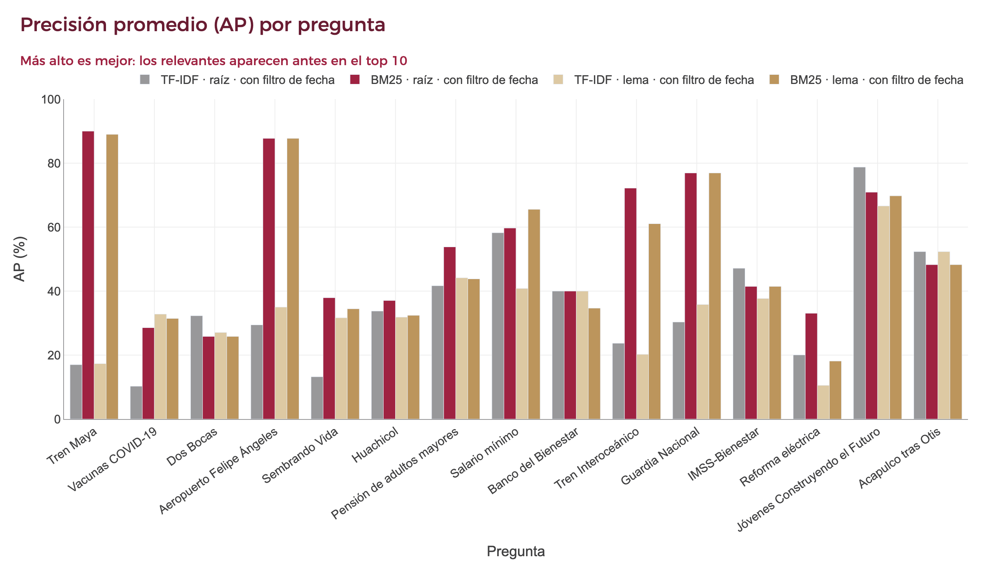

<header class="cabecera-articulo">

Proyecto final · Minería de Textos

<h1>Recuperación y extracción de información sobre discursos presidenciales</h1>

Equipo Datisa

<ul class="autores">
<li>Carpio Angeles Leo Yahir</li>
<li>Jaramillo Salmerón Arturo</li>
<li>Mera Montiel Gonzalo Sebastian</li>
<li>Moctezuma Ramirez Diego Rafael</li>
<li>Ramirez Maza Luis</li>
</ul>

<time datetime="2026-11-25">25 de noviembre de 2026</time> · <a href="https://github.com/DiegoMoctezuma/Examen_Mineria_Textos">Repositorio del proyecto</a>

</header>

Este reporte describe la versión final del sistema. Parte del examen entregado el 11 de noviembre (v1) y atiende la retroalimentación del profesor con más preguntas, juicios de tres personas, un gold más grande con doble anotación, una comparación de modelos NER y referencias para leer el F1. La tabla resume qué cambió; las cifras v1 se conservan en el repositorio y no se sobrescriben.

**Tabla 1. Resumen de los cambios entre versiones**

| Tema | Examen (v1) | Proyecto final (v2) |
| --- | --- | --- |
| Preguntas | 10 | 15 (se suman Guardia Nacional, IMSS-Bienestar, Reforma eléctrica, Jóvenes Construyendo el Futuro y Acapulco tras Otis) |
| Variantes de búsqueda | 4: TF-IDF y BM25, con y sin filtro | 8: las mismas con raíz (stemming) y con lema |
| Juicios de relevancia | 1 persona, 176 pares | 3 personas por par, mayoría, 320 pares, κ de Fleiss 0.48 |
| Mejor búsqueda | BM25 con filtro, MAP 48.4 % | BM25 con raíz y filtro, MAP 53.6 % (IC95 43.3 % a 64.1 %) |
| Modelo NER | mrm8488, elegido por criterio técnico | XLM-RoBERTa large, elegido entre 4 por F1 sobre un conjunto de selección |
| Gold de entidades | 20 pasajes, 1 persona | 35 pasajes: los 20 de v1 más 15 nuevos con doble anotación y adjudicación |
| F1 combinado | 78.4 % | 82.7 % (IC95 77.1 % a 88.2 %), con 85.3 % como referencia de concordancia humana y 65.4 % como línea base |

Fuentes: salida/v2/resultados_ir.csv, salida/v2/05_robustez.csv, salida/v2/05a_acuerdo.csv, salida/v2/09_comparacion_ner.csv, salida/v2/resultados_ie.csv, salida/v2/09_referencias_f1.csv; v1 en salida/.

## 1. Datos, limpieza y segmentación

El corpus son las versiones estenográficas de conferencias y discursos presidenciales de diciembre de 2018 a septiembre de 2024. Esta parte no cambió en v2, porque cambiarla invalidaría los juicios y el gold de v1. De 2,294 discursos descargados se excluyen 4 duplicados exactos y 1 casi duplicado (2,289), y 2,288 producen al menos un pasaje. La limpieza elimina 7,338 acotaciones del transcriptor, que son notas como «inaudible», «inicia video» o «himno nacional» y no palabras de nadie; cada eliminación queda auditada. Las marcas de interlocutor llegan como etiquetas en línea que el reconocedor del kit no detecta en ningún discurso, por lo que la limpieza las canoniza a una intervención por línea antes de segmentar.

**Tabla 2. Corpus y segmentación**

| Concepto | Valor |
| --- | --- |
| Discursos descargados / sin duplicados / con pasajes | 2,294 / 2,289 / 2,288 |
| Periodo | 2018-12-02 a 2024-09-30 |
| Acotaciones eliminadas | 7,338 |
| Pasajes indexados | 127,739 |
| Pasajes de reporteros | 19,844 (15.5 %) |

La unidad de recuperación es el pasaje: cada intervención se parte en ventanas de 200 palabras con paso de 150 y mínimo de 40. La marca del interlocutor se reinyecta al inicio del pasaje para extraer personas y cargos, y se excluye del índice. Los pasajes de reporteros se indexan como cualquier otro: el 15.5 % del índice son preguntas, y sirven porque nombran el tema. Lo que se descarta es todo fragmento de menos de 40 palabras, sea de quien sea, porque es demasiado corto para entenderse solo; eso afecta al 64.94 % de las intervenciones de reporteros, que suelen ser breves. En las tablas de respuesta lo que dice un reportero nunca cuenta como respaldo (sección 6).

## 2. Preprocesamiento e índice invertido

Los textos se normalizan a NFC y minúsculas; los tokens son secuencias alfanuméricas con un guion interno opcional, lo que conserva covid-19. Se quitan las palabras vacías que no distinguen temas: 336 en total, las de NLTK más una lista propia de la estenográfica (presidente, gracias, pregunta, entonces, pues). En v1 cada palabra se reduce a su raíz con el stemmer Snowball; en v2 se agrega una segunda versión con el lema de spaCy (es_core_news_md), con los mismos tokens, de modo que solo cambia la forma base. El lema separa palabras que la raíz junta: maya y mayo comparten la raíz may (6,504 pasajes), y con lema quedan como maya (4,344) y mayo (2,151). El vocabulario pasa de 35,891 a 68,482 términos.

El índice invertido se escribe a mano: para cada término guarda la lista de pasajes donde aparece con su frecuencia, y la longitud de cada pasaje (72.2 tokens en promedio). La rareza de un término se mide con el idf: entre menos pasajes lo contienen, más pesa.

**Tabla 3. Postings de términos seleccionados**

| Término | Raíz | Pasajes | % de pasajes | idf BM25 |
| --- | --- | ---: | ---: | ---: |
| programa | program | 12,803 | 10.02 | 2.30 |
| tren | tren | 5,261 | 4.12 | 3.19 |
| refinería | refin | 2,069 | 1.62 | 4.12 |
| huachicol | huachicol | 714 | 0.56 | 5.19 |

Fuentes: salida/02_postings.md y salida/v2/02_comparacion_stem_lema.md.

## 3. Ranking y evaluación de IR

TF-IDF usa tf sublineal e idf suavizado, $w = (1+\ln tf)\,(\ln\frac{1+N}{1+df}+1)$, con similitud coseno. BM25 se implementa a mano con $k_1 = 1.5$ y $b = 0.75$, idf $\ln\left(1+\frac{N-df+0.5}{df+0.5}\right)$ y puntaje $\sum_t idf_t \frac{tf\,(k_1+1)}{tf + k_1(1-b+b\,|d|/avgdl)}$. Cada modelo corre con raíz y con lema, con y sin el filtro de fecha de la pregunta, y devuelve los 10 mejores pasajes.

**Juicios.** El pool es la unión de los 10 primeros de las 8 variantes: 320 pares (176 de v1 y 144 nuevos). Cada par lo juzgaron tres personas por separado, sin ver modelo, rango ni puntaje; un par es relevante si al menos 2 de 3 dicen que sí (196 de 320). El acuerdo entre jueces es moderado: κ de Fleiss de 0.48 (0.42 en el lote 1 y 0.54 en el lote 2).

**Resultados.** El ganador se elige entre las variantes con filtro, porque el sistema siempre usa el periodo de la pregunta (regla fijada antes de ver los juicios). Gana BM25 con raíz y filtro, con MAP de 53.6 %. El intervalo de confianza del 95 % se calcula con 10,000 remuestreos de las preguntas.

**Tabla 4. Evaluación de recuperación v2**

| Variante | P@5 | P@10 | MAP | IC95 |
| --- | ---: | ---: | ---: | --- |
| BM25 raíz con filtro | 0.79 | 0.77 | **0.536** | 0.433 a 0.641 |
| BM25 raíz sin filtro | 0.76 | 0.75 | 0.527 | 0.410 a 0.640 |
| BM25 lema sin filtro | 0.79 | 0.72 | 0.515 | 0.403 a 0.626 |
| BM25 lema con filtro | 0.76 | 0.72 | 0.507 | 0.399 a 0.618 |
| TF-IDF raíz con filtro | 0.64 | 0.59 | 0.352 | 0.267 a 0.445 |
| TF-IDF lema con filtro | 0.67 | 0.61 | 0.349 | 0.283 a 0.418 |
| TF-IDF lema sin filtro | 0.61 | 0.59 | 0.337 | 0.259 a 0.412 |
| TF-IDF raíz sin filtro | 0.57 | 0.55 | 0.331 | 0.232 a 0.434 |

<figure><figcaption>Figura 1. AP por pregunta y variante, 15 preguntas.</figcaption></figure>

Fuentes: salida/v2/05_ir_8_variantes.csv y salida/v2/05_robustez.csv.

La ventaja de BM25 sobre TF-IDF con filtro (18.4 puntos de MAP) es estable: una prueba de permutación pareada sobre las 15 preguntas da p = 0.014. Por pregunta, BM25 gana en 10, TF-IDF en 4 (Dos Bocas, IMSS-Bienestar, Jóvenes Construyendo el Futuro y Acapulco tras Otis) y hay un empate (Banco del Bienestar). La saturación de frecuencias y la normalización por longitud de BM25 pueden contribuir a explicar su mejor desempeño observado. En Tren Maya, el AP fue de 0.90 con BM25 y de 0.17 con TF-IDF. Dos de las preguntas que gana TF-IDF tienen un nombre alterno que no está en la consulta: Dos Bocas, que el corpus también llama refinería Olmeca, e IMSS-Bienestar, que hasta 2023 aparece como Insabi. En esos casos ningún modelo léxico encuentra el sinónimo, y un modelo de embeddings densos sería el siguiente paso natural.

El lema no mejora el MAP: con filtro, la raíz da 53.6 % y el lema 50.7 %, y la diferencia no es significativa (p = 0.07). No se encontró evidencia de una diferencia significativa en el MAP de BM25 al aplicar el filtro de fecha (53.6 % frente a 52.7 %, p = 0.81), bajo un criterio de relevancia temática que no considera la fecha. La regla de mayoría no decide el ganador: con unanimidad (3 de 3) BM25 con raíz y filtro baja a 35.5 % y con al menos un voto sube a 56.3 %, y en los dos casos sigue primero. El MAP de v2 no se compara directamente con el de v1: en Q1 a Q10 la misma lista de BM25 con filtro obtiene 63.5 % si solo cuentan los pares del pool v1 y 53.3 % con el pool v2, porque un pool más grande conoce más relevantes.

**Contraste con el modelo booleano.** El booleano devuelve un conjunto sin orden y trata igual a todos los términos, aunque su idf sea muy distinto. Dentro del periodo de cada pregunta, la búsqueda con Y no devuelve nada en Banco del Bienestar ni en Acapulco tras Otis y devuelve 1 y 2 pasajes en Reforma eléctrica y Tren Interoceánico; con O devuelve entre 1,441 y 35,078. En Huachicol, la búsqueda con O trae 1,485 pasajes y 1,261 no contienen la palabra huachicol, mientras que los 10 primeros de BM25 sí la contienen (salida/v2/03b_booleano.csv).

## 4. Extracción con reglas y con modelo

Las reglas deterministas detectan fechas y montos a partir de patrones explícitos, consultan gazetteers de organizaciones y lugares e identifican personas en la marca de interlocutor. El gazetteer extendido reúne 152 entradas del kit, adiciones manuales y siglas revisadas. El de lugares tiene 102 entradas. El NER usa el contexto para reconocer menciones de PER, ORG y LOC que las reglas pueden omitir. Los porcentajes y otras cantidades no monetarias se registran como auxiliares.

Se compararon cuatro candidatos en 10 pasajes con doble anotación y adjudicación, separados del gold de evaluación. El criterio fue el F1 micro del modelo solo en PER, ORG y LOC, con coincidencia exacta de pasaje, tipo y límites. XLM-R large se fijó antes del cierre del gold.

**Tabla 5. Selección del NER**

| Modelo · revisión abreviada | F1 micro |
|---|---:|
| XLM-R large (Davlan) · 1f929ffad9b7 | 0.6780 |
| XLM-R base (Davlan) · 253f557bd824 | 0.6129 |
| BERT mrm8488 · b11721d41d9e | 0.2712 |
| spaCy es_core_news_lg · 3.8.0 | 0.2623 |

*Fuentes: salida/06_resumen_reglas.json, salida/v2/09_comparacion_ner.csv y data/modelo_ner.json.*

El NER elegido procesa ventanas solapadas y proyecta sus límites sobre el texto original. Si $E_r$ y $E_m$ son las detecciones de reglas y modelo, identificadas por pasaje, tipo, inicio y fin, la fusión entrega $E_r \cup E_m$ y atribuye $E_r \cap E_m$ a ambas fuentes. Conserva por separado los desacuerdos de tipo o límites. La normalización de fechas y montos preserva los tramos evaluados.

Las reglas FECHA v2 amplían formatos e intervalos. Su comparación se considera exploratoria porque la anotación mantuvo el criterio v1. Las cifras escritas íntegramente con letra siguen siendo una limitación de MONTO.

## 5. Evaluación de IE y análisis de errores

El gold v2 reúne 35 pasajes, incluidos los 20 de v1 y 15 nuevos con doble anotación ciega y adjudicación. El kit evalúa los 34 con entidades y deja fuera los posibles falsos positivos del pasaje sin entidades gold. Un acierto exige coincidencia exacta de pasaje, tipo, inicio y fin. El agregado micro acumula TP, FP y FN antes de calcular las métricas.

$$
P=\frac{\mathrm{TP}}{\mathrm{TP}+\mathrm{FP}},\qquad
R=\frac{\mathrm{TP}}{\mathrm{TP}+\mathrm{FN}},\qquad
F_1=\frac{2PR}{P+R}.
$$

**Tabla 6. Evaluación exacta por versión y método (P/R/F1)**

| Versión · método | PER | ORG | LOC | FECHA | MONTO | Total |
|---|---:|---:|---:|---:|---:|---:|
| v1 · reglas | 1.00/0.79/0.88 | 0.85/0.62/0.72 | 0.91/0.70/0.79 | 0.40/0.33/0.36 | 1.00/1.00/1.00 | 0.89/0.69/0.78 |
| v1 · modelo | 0.22/0.26/0.24 | 0.66/0.62/0.64 | 0.86/0.72/0.78 | s/c | s/c | 0.70/0.61/0.65 |
| v1 · combinado | 0.51/1.00/0.68 | 0.67/0.78/0.72 | 0.84/0.87/0.85 | 0.40/0.33/0.36 | 1.00/1.00/1.00 | 0.73/0.85/0.78 |
| v2 · reglas | 1.00/0.72/0.84 | 0.91/0.64/0.75 | 0.90/0.68/0.78 | 0.57/0.50/0.53 | 0.83/0.83/0.83 | 0.90/0.68/0.77 |
| v2 · modelo | 0.89/0.94/0.92 | 0.69/0.72/0.70 | 0.84/0.69/0.76 | s/c | s/c | 0.80/0.68/0.74 |
| v2 · combinado | 0.90/1.00/0.95 | 0.68/0.80/0.74 | 0.84/0.87/0.86 | 0.57/0.50/0.53 | 0.83/0.83/0.83 | **0.80/0.86/0.83** |
| Soporte v1/v2 | 19/36 | 37/61 | 98/123 | 6/8 | 3/12 | 163/240 |

*Fuentes: salida/resultados_ie.csv de v1.0-entrega y salida/v2/resultados_ie.csv. s/c: sin cobertura. El kit asigna cero cuando el denominador de la métrica es nulo.*

En v2, la fusión elevó el recall frente a ambos métodos individuales (0.8583 frente a 0.6792) y redujo la precisión frente a las reglas (0.7984 frente a 0.9006). Obtuvo el mayor F1 micro en la misma muestra (0.8273). Su IC del 95 % (0.7714–0.8818) usa los percentiles 2.5 y 97.5 de 10 000 réplicas bootstrap de los 34 pasajes, con reemplazo y semilla 42. Frente al F1 combinado v1 (0.7841), el contraste es descriptivo por las diferencias de muestra y soporte.

La línea base de solo gazetteer obtuvo 0.6543. La referencia de concordancia humana exacta previa a la adjudicación fue 0.8533 en A y B, con un ámbito distinto al del kit. El F1 parcial del método combinado v2 fue 0.9259. El criterio admite un solape de al menos un carácter entre una predicción y una entidad gold del mismo tipo y pasaje.

<figure class="figura-ie"><figcaption>Figura 2. F1 exacto por tipo con línea base y referencia de concordancia humana.</figcaption></figure>

*Fuente: salida/v2/figuras/s7a_f1_con_referencias.png y salida/v2/09_referencias_f1.csv. Concordancia humana: 15 pasajes de A+B. Sistema y línea base: 34 pasajes del kit.*

**Tabla 7. FECHA exploratoria sobre el mismo gold con criterio v1**

| Reglas | P | R | F1 | Soporte |
|---|---:|---:|---:|---:|
| FECHA v1 | 0.5714 | 0.5000 | 0.5333 | 8 |
| FECHA v2 | 0.5714 | 0.5000 | 0.5333 | 8 |

*Fuente: salida/v2/09_referencias_f1.csv.*

Se observaron entidades partidas, como «Pfizer-BioNTech» detectada en dos tramos, y errores de tipo, como «Corredor Interoceánico del Istmo de Tehuantepec» marcado como ORG. «VOZ MUJER» se detectó como ORG en la marca. Hubo errores de límite en montos que conservaban la unidad. No se observaron casos de monto sin unidad ni de sigla no reconocida.

La evaluación mide el reconocimiento de entidades en los pasajes evaluados. Responder una consulta también exige recuperar pasajes pertinentes y aportar una cita que respalde la relación solicitada, como se examina en la sección 6.

*Fuente de los ejemplos: salida/v2/09_analisis_errores.csv.*

## 6. Tablas de respuesta

Para cada pregunta se responde su pregunta de extracción con las entidades del top 10 del ganador, después de quitar las entidades de la marca de interlocutor y las variantes del nombre del presidente en los campos de persona. Cada dato tiene un estado con su evidencia. **Respaldado:** una cita textual de quien declara lo sostiene, por ejemplo «262 sucursales» en Banco del Bienestar, con la frase «Ya en el caso de Oaxaca son 262 sucursales» (14 de enero de 2023). **Ambiguo:** el dato aparece, pero lo dice un reportero o la cita no basta para afirmarlo, como «Michoacán» en Huachicol, que sale de la pregunta de la prensa «¿Cuánto era el presupuesto de Michoacán?» (6 de abril de 2019). **Sin evidencia:** el sistema no identificó evidencia para el campo solicitado en los diez pasajes recuperados. De 375 datos, 248 están respaldados, 122 son ambiguos y 5 no tienen evidencia. Respaldado significa que el texto lo afirma, no que sea verdad.

**Tabla 8. Estados de respuesta por consulta**

| Pregunta | Resp. | Amb. | Sin ev. | Pregunta | Resp. | Amb. | Sin ev. |
| --- | ---: | ---: | ---: | --- | ---: | ---: | ---: |
| Tren Maya | 5 | 3 | 1 | Banco del Bienestar | 25 | 2 | 0 |
| Vacunas COVID-19 | 21 | 3 | 0 | Tren Interoceánico | 39 | 22 | 0 |
| Dos Bocas | 9 | 9 | 0 | Guardia Nacional | 38 | 6 | 0 |
| Aeropuerto Felipe Ángeles | 28 | 7 | 0 | IMSS-Bienestar | 10 | 7 | 1 |
| Sembrando Vida | 9 | 12 | 0 | Reforma eléctrica | 19 | 9 | 0 |
| Huachicol | 9 | 5 | 0 | Jóvenes Construyendo el Futuro | 9 | 3 | 1 |
| Pensión de adultos mayores | 11 | 8 | 0 | Acapulco tras Otis | 10 | 24 | 1 |
| Salario mínimo | 6 | 2 | 1 | | | | |

Fuente: salida/v2/respuestas.csv; tablas completas con cita y pasaje en salida/v2/tablas_respuesta.

Las valoraciones humanas disponibles identificaron errores recurrentes de clasificación, entidades poco pertinentes, ausencia de información solicitada y confusión entre montos individuales y globales. Estas observaciones muestran que el reconocimiento de entidades no garantiza por sí mismo la pertinencia ni la suficiencia de las respuestas.

## 7. Uso de IA, siguientes pasos y reproducibilidad

Los integrantes realizaron los juicios de relevancia, las anotaciones, las adjudicaciones y las valoraciones humanas. La asistencia de IA se empleó en el desarrollo del sistema, la elaboración de pruebas y figuras, la revisión metodológica y la redacción del reporte. Las decisiones metodológicas y la interpretación de los resultados fueron revisadas por el equipo. El proyecto incorpora pruebas automatizadas y mecanismos de validación para favorecer su reproducibilidad.

Las limitaciones observadas orientan mejoras específicas. Para las consultas con menor AP (Dos Bocas, 0.26, y Vacunas COVID-19, 0.29), se propone incorporar sinónimos y nombres alternos y evaluar representaciones densas. Para la extracción se propone ampliar los diccionarios con nombres completos de obras e instituciones, extender las reglas de montos a intervalos y cifras en letra, y evaluar FECHA sobre una muestra mayor, dado su soporte de 8 entidades. La unión de intervenciones breves consecutivas permitiría evaluar la recuperación de preguntas de reporteros que quedan por debajo de 40 palabras.

En una laptop sin GPU, la reconstrucción desde un clon limpio con insumos humanos y caché NER versionados tomó 18 min 33 s, incluidos 15 min 43 s de lematización. Los seis CSV de entrega, los CSV de salida v2 y las figuras verificadas coincidieron byte por byte (docs/reproducibilidad.md). En la revisión evaluada, `make test` registró 742 pruebas aprobadas y `make validar` verificó 20 de 22 condiciones de entrega. El NER y las reglas de FECHA v2 se fijaron antes del cierre del gold. La segunda pasada de anotación comenzó antes de fijar esas reglas y aplicó el criterio de FECHA v1.
